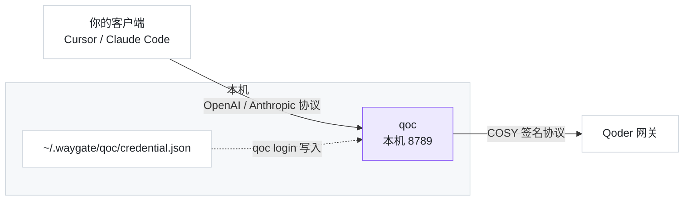

# waygate-qoder

<div align="center">

**途关 · Qoder CN 反代**

把 Qoder CN 客户端的订阅，变成你自己的本地 API

[](https://www.npmjs.com/package/waygate-qoder)


[快速开始](#快速开始) · [客户端配置](#客户端怎么填) · [工作原理](#工作原理) · [常见问题](#常见问题) · [相关项目](#相关项目)

</div>

---

**读取本机 Qoder 客户端的登录态，在本机起一个 Anthropic / OpenAI 兼容的聊天端点** ——
Cursor、Claude Code、Cherry Studio、任何能改 base_url 的工具，都能直接用你的订阅额度。

- **零配置接入** —— 一条命令起服务，打印出「代理地址 + 密钥 + 模型 ID」，复制粘贴即可
- **两个协议都认** —— `POST /v1/chat/completions`（OpenAI 兼容）与 `POST /v1/messages`（Anthropic 兼容）
- **只在本机转** —— 读本机客户端文件、写 `~/.waygate/`、本机转发；不向任何第三方上传数据

## 快速开始

```bash
# 全局安装（之后命令就是 qoc）
npm i -g waygate-qoder

# 启动
qoc
```

```
途关 · Qoder CN 反代 v0.1.4

凭证    ✓ 已登录：你的账号（uid 01a0d156…）
上游    https://gateway.qoder.com.cn  (COSY 签名协议)
代理    http://127.0.0.1:8789/v1   （OpenAI 系客户端：Cursor / Cherry Studio / OpenAI SDK）
        http://127.0.0.1:8789      （Anthropic 系客户端：Claude Code，它自己会补 /v1）
密钥    sk-qoc-1a2b3c4d5e6f7a8b9c0d1e2f3a4b5c6d

模型 ID（填进你的客户端）：
  qmodel_38max   Qwen3.8-Max
  qfmodel        Qwen3.8-Flash
  qmodel         Qwen3.7-Plus
  …（共 14 个）

把上面的「代理地址 + 密钥」填进 Cursor / Claude Code / Cherry Studio 等客户端即可。
按 Ctrl+C 停止。
```

> 不想全局装：`git clone` 后 `npm install && npm run build && node dist/index.js`。

**要求**：Node.js ≥ 20；本机装有 Qoder CN 桌面客户端**且已登录**。

## 命令

```bash
qoc                  # 启动反代（同 qoc serve），打印模型 ID 与代理地址
qoc models           # 只列出模型 ID（不起服务）
qoc doctor           # 自检：端口 / 凭证 / 模型清单 / 上游连通
qoc login            # 重新读取客户端登录态（令牌过期时用）
```

| 参数 | 说明 |
| --- | --- |
| `--port <n>` | 监听端口（默认 8789） |
| `--host <addr>` | 监听地址（默认 `127.0.0.1`） |
| `--key <sk-…>` | 指定入站密钥（默认自动生成并缓存） |
| `--json` | 机器可读输出 |
| `--verbose` | 打印每个请求的路由日志 |

## 客户端怎么填

**Cursor / Cherry Studio / OpenAI SDK**

- Base URL：`http://127.0.0.1:8789/v1`
- API Key：启动时打印的 `sk-qoc-…`
- 模型：模型 ID（如 `qfmodel`）

**Claude Code**

```bash
ANTHROPIC_BASE_URL=http://127.0.0.1:8789
ANTHROPIC_API_KEY=sk-qoc-…
```

暴露的端点：`POST /v1/chat/completions` · `POST /v1/messages` · `GET /v1/models` · `GET /healthz`

支持流式（SSE）与非流式（`stream: false` 时自动聚合为单个 JSON）两种响应模式。

## 工作原理



- **凭证**：Qoder 客户端把登录态存在 Chromium 的 `auth.v1.dat`（os_crypt **v10**，密钥由 Windows **DPAPI** 保护）。`qoc login` 用本机 DPAPI 解出令牌，写到 `~/.waygate/qoc/credential.json`（0600）。
- **协议**：Qoder 网关用一套自研签名（**COSY** bearer + 自定义 base64 编码）与 SSE 帧格式；本工具把它翻译成标准 OpenAI SSE 形状下发。
- **模型清单**：真拉网关 `/model/list`（不是内置假清单），模型 `id` 即客户端请求要填的 key。

> [!NOTE]
> **遇到大上下文时偶发「HTTP 200 但零字节」** —— 这是 Qoder 网关的已知现象（实测 2.7 万 token 时会先空转近 30 秒才断流）。本工具会自动重发一次（最多 1 次），客户端只会感到响应稍慢，不会收到半截内容。

## 常见问题

**要装 Qoder 客户端吗？** 要。本工具不提供账号，只是把你**已有**的客户端登录态转成本地 API。

**令牌过期了怎么办？** 在 Qoder 客户端重新登录，然后跑一次 `qoc login`；`qoc doctor` 会告诉你凭证是否还有效。

**会不会把我的令牌上传？** 不会。全程只在本机读写：读客户端文件 → 写 `~/.waygate/` → 本机转发。代码开源可查。

**端口被占用？** `qoc --port 9790`，或 `qoc doctor` 看是哪一项没过。

**支持 macOS / Linux 吗？** 暂只支持 Windows —— 客户端用 **DPAPI**（Windows 专有）保护密钥。

> [!WARNING]
> **想给局域网其他设备用？** 加 `--host 0.0.0.0` —— 请想清楚：那等于把你订阅的额度开放给能访问该端口的所有人。

## 免责声明

仅供**个人学习与研究**使用，请遵守 Qoder 的服务条款。上游接口随时可能变更，届时本工具可能失效（`qoc doctor` 是排查入口）。作者不对使用后果负责。

## 相关项目

- **[waygate-mmcode](https://github.com/zhanghaojie513/waygate-mmcode)** —— 同款工具，对应 MiniMax Code（`npm i -g waygate-mmcode`）
- **[waygate-core](https://github.com/zhanghaojie513/waygate-core)** —— 两个工具共用的骨架（`npm i waygate-core`）
- **[relay-station](https://github.com/zhanghaojie513/relay-station)** —— 同一作者的完整多提供商反代（含控制台、用量统计）

## License

MIT
