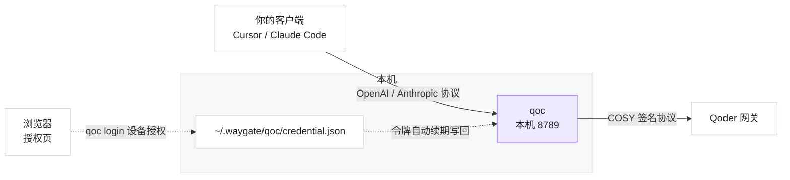

# waygate-qoder

<div align="center">

**途关 · Qoder CN 反代**

把 Qoder CN 客户端的订阅，变成你自己的本地 API

[](https://www.npmjs.com/package/waygate-qoder)


[快速开始](#快速开始) · [客户端配置](#客户端怎么填) · [工作原理](#工作原理) · [常见问题](#常见问题) · [相关项目](#相关项目)

</div>

---

**用官方 CLI 的浏览器设备授权登录，在本机起一个 Anthropic / OpenAI 兼容的聊天端点** ——
Cursor、Claude Code、Cherry Studio、任何能改 base_url 的工具，都能直接用你的订阅额度。

- **零配置接入** —— 一条命令起服务，打印出「代理地址 + 密钥 + 模型 ID」，复制粘贴即可
- **浏览器授权登录** —— `qoc login` 打印授权链接，浏览器选账号即可；**不需要装桌面客户端**，
  服务器上也能自助登录（不再依赖 Windows / DPAPI）
- **两个协议都认** —— `POST /v1/chat/completions`（OpenAI 兼容）与 `POST /v1/messages`（Anthropic 兼容）
- **只在本机转** —— 写 `~/.waygate/`、本机转发；不向任何第三方上传数据

## 快速开始

```bash
# 全局安装（之后命令就是 qoc）
npm i -g waygate-qoder

# 登录：打印授权链接（浏览器打开、选你的 Qoder 账号完成授权）
qoc login

# 启动
qoc
```

`qoc login` 会**原地等你 2 分钟** —— 你在浏览器选完账号，终端**自动继续**，无需再来一次。
若超过 2 分钟，它会提示你用 `qoc login-poll` 续取（授权会话 5 分钟内有效）：

```
请用浏览器打开下面的链接完成授权（选你的 Qoder 账号）：

  https://qoder.cn/device/selectAccounts?challenge=...&nonce=...&machine_id=...&client_id=...

完成后本终端会**自动继续**（最多等 120 秒）。

  ⏳ 等待授权完成… 3s（最多再等 117s，按 Ctrl+C 可中断）

✓ 登录成功 → ~/.waygate/qoc/credential.json
账号 你的账号（uid 01a0d156…），令牌有效约 60 分钟
```

```
途关 · Qoder CN 反代 v0.3.7

凭证    ✓ 已登录：你的账号（uid 01a0d156…；令牌有效约 58 分钟）
上游    https://gateway.qoder.com.cn  (COSY 签名协议)
代理    http://127.0.0.1:8789/v1   （OpenAI 系客户端：Cursor / Cherry Studio / OpenAI SDK）
        http://127.0.0.1:8789      （Anthropic 系客户端：Claude Code，它自己会补 /v1）
密钥    sk-qoc-1a2b3c4d5e6f7a8b9c0d1e2f3a4b5c6d

模型 ID（填进你的客户端）：
  qmodel_38max   Qwen3.8-Max
  qfmodel        Qwen3.8-Flash
  qmodel         Qwen3.7-Plus
  …（共 14 个）

把上面的「代理地址 + 密钥」填进 Cursor / Claude Code / Cherry Studio 等客户端即可。
按 Ctrl+C 停止。
```

> 不想全局装：`git clone` 后 `npm install && npm run build && node dist/index.js`。

**要求**：Node.js ≥ 20；**不需要**装 Qoder 桌面客户端（登录走浏览器授权，Windows / macOS / Linux 都可以）。

## 命令

```bash
qoc                  # 启动反代（同 qoc serve），打印模型 ID 与代理地址
qoc models           # 只列出模型 ID（不起服务）
qoc login            # 登录：打印授权链接并原地等 2 分钟（超时提示改用 login-poll）
qoc login-poll       # 完成登录：浏览器授权后取票（`login` 等待超时也用它）
qoc checkin          # 每日签到领 100 Credits（用本工具令牌代签，无需开客户端）
qoc credits          # 积分概况（剩余余额 / 累计消耗 / 连续活跃）
qoc doctor           # 自检：端口 / 凭证 / 模型清单 / 上游连通
qoc login            # 登录：打印授权链接并原地等 2 分钟（超时提示改用 login-poll）
qoc login-poll       # 完成登录：浏览器授权后取票（`login` 等待超时也用它）
```

> [!NOTE]
> `checkin` / `credits` 走 Qoder 的 OpenAPI（`openapi.qoder.com.cn`），鉴权只用本工具维护的
> Bearer 令牌 —— **签到不需要打开 Qoder 客户端**，也不会顶掉你的桌面登录。
>
> **签到规则（Qoder 官方标注）**：每日 **10:00（UTC+8）** 刷新，**领取后 30 天有效**，每天 100 Credits。
> 也就是说签到的积分**有保质期**，最迟在领取后 30 天内用掉；`qoc checkin` 的输出末尾会带上这句。
>
> **`credits` 里两个数的口径别混**（命令输出末尾也会再讲一遍）：
>
> - **剩余积分** = 当前可用余额，来自 `v2/me/usage`（`addOnQuota` 资源包 + `userQuota` 套餐内），
>   与桌面端「我的用量」那张卡一致。签到赠送的 100 Credits 进资源包，所以签完这里会涨。
> - **累计消耗** = 该账号**在近一年里于该平台消耗掉的 credits 总量**。它**不是余额**，
>   也**不是「本工具转发的那部分」** —— 是**账号级**口径，含官方客户端直连的用量。
>   数值上等于每日消耗热力图近 371 天之和（`credits-summary.totalCredits`）。

| 参数 | 说明 |
| --- | --- |
| `--port <n>` | 监听端口（默认 8789） |
| `--host <addr>` | 监听地址（默认 `127.0.0.1`） |
| `--key <sk-…>` | 指定入站密钥（默认自动生成并缓存） |
| `--json` | 机器可读输出 |
| `--verbose` | 打印每个请求的路由日志 |

## 客户端怎么填

**Cursor / Cherry Studio / OpenAI SDK**

- Base URL：`http://127.0.0.1:8789/v1`
- API Key：启动时打印的 `sk-qoc-…`
- 模型：模型 ID（如 `qfmodel`）

**Claude Code**

```bash
ANTHROPIC_BASE_URL=http://127.0.0.1:8789
ANTHROPIC_API_KEY=sk-qoc-…
```

暴露的端点：`POST /v1/chat/completions` · `POST /v1/messages` · `GET /v1/models` · `GET /healthz`

支持流式（SSE）与非流式（`stream: false` 时自动聚合为单个 JSON）两种响应模式。

## 工作原理



- **凭证**：走 **官方 Qoder CLI 的浏览器设备授权**（`qoc login`）—— 打印授权链接、你在浏览器选账号，
  取票写到 `~/.waygate/qoc/credential.json`（0600）。**不读本机客户端文件、不做任何解密**，
  故 Windows / macOS / Linux 都能用，服务器上也能自助登录。
  拿到的令牌含 `security_oauth_token`，与桌面端同源 —— 直接喂给下面的 COSY 身份块。
  令牌到期前 5 分钟**自动续期**（`deviceToken/refresh`；注意 refresh token 会轮换，本工具自动写回）。
- **协议**：Qoder 网关用一套自研签名（**COSY** bearer + 自定义 base64 编码）与 SSE 帧格式；本工具把它翻译成标准 OpenAI SSE 形状下发。
- **模型清单**：真拉网关 `/model/list`（不是内置假清单），模型 `id` 即客户端请求要填的 key。

> [!NOTE]
> **遇到大上下文时偶发「HTTP 200 但零字节」** —— 这是 Qoder 网关的已知现象（实测 2.7 万 token 时会先空转近 30 秒才断流）。本工具会自动重发一次（最多 1 次），客户端只会感到响应稍慢，不会收到半截内容。

## 常见问题

**要装 Qoder 客户端吗？** **不要。** 登录走浏览器设备授权（`qoc login`），任何能开浏览器的机器都行 —— 服务器上也能自助登录。

**令牌过期了怎么办？** 本工具**自动续期**（到期前 5 分钟刷新并写回），通常无需干预。
若 refresh token 也失效（例如同一账号在别处登录过），重跑 `qoc login`（等 2 分钟；超时用 `qoc login-poll` 续取）。

**会不会把我的令牌上传？** 不会。全程只在本机读写：浏览器授权 → 写 `~/.waygate/` → 本机转发。代码开源可查。

**端口被占用？** `qoc --port 9790`，或 `qoc doctor` 看是哪一项没过。

**支持 macOS / Linux 吗？** 支持。登录是纯 HTTP 设备授权，没有平台专有依赖（旧版依赖 Windows DPAPI，已弃用）。

> [!WARNING]
> **想给局域网其他设备用？** 加 `--host 0.0.0.0` —— 请想清楚：那等于把你订阅的额度开放给能访问该端口的所有人。

## 免责声明

仅供**个人学习与研究**使用，请遵守 Qoder 的服务条款。上游接口随时可能变更，届时本工具可能失效（`qoc doctor` 是排查入口）。作者不对使用后果负责。

## 相关项目

- **[waygate-mmcode](https://github.com/zhanghaojie513/waygate-mmcode)** —— 同款工具，对应 MiniMax Code（`npm i -g waygate-mmcode`）
- **[waygate-workbuddy](https://github.com/zhanghaojie513/waygate-workbuddy)** —— 同款工具，对应 WorkBuddy（`npm i -g waygate-workbuddy`）
- **[waygate-core](https://github.com/zhanghaojie513/waygate-core)** —— 三个工具共用的骨架（`npm i waygate-core`）
- **[waygate-open](https://github.com/zhanghaojie513/waygate-open)** —— 同一作者的完整多提供商反代（含控制台、用量统计）

## License

MIT
